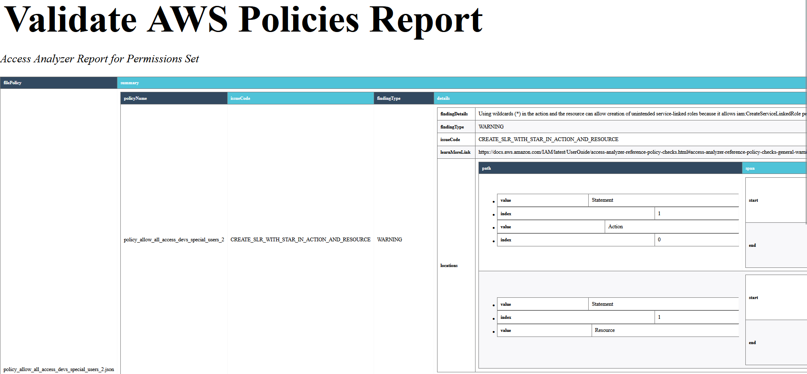

# Validate AWS policies 

This package validates AWS IAM policies (identity, resource, SCP and RCP) with the IAM Access Analyzer
`ValidatePolicy` API and creates reports in HTML, Markdown or JUnit XML format.

# Pre-Requirements
Setup AWS Cli profile for interacting with IAM access analyzer API using IAM or SSO credentials.

# Requirements 

- python >= 3.8

## Install

```commandline
$ pip install --upgrade validate-aws-policies
```
### From AWS CodeArtifacts repository

>You must have a user into AWS account Sophos Organization, it could be for projects, products, or IT internal Organizations.
> Before create AWS CLI profile using [AWS IAM Identity Center (SSO)](https://docs.aws.amazon.com/cli/latest/userguide/sso-configure-profile-token.html) or IAM.


1. Configure your pip cli for download package from private CodeArtifacts repository 

```commandline 

$ aws codeartifact login --tool pip --repository <repository_name> --domain <domain> --domain-owner <123456789012>  --profile <profile_name> --region <repository_region>
$ pip install --upgrade validate-aws-policies

```
### From Azure Artifacts repository

#### Project setup
Ensure you have installed the latest version of the Azure Artifacts keyring from the "Get the tools" menu.

If you don't already have one, create a virtualenv using [these instructions](https://go.microsoft.com/fwlink/?linkid=2103878) from the official Python documentation. Per the instructions, "it is always recommended to use a virtualenv while developing Python applications."

Add a pip.ini (Windows) or pip.conf (Mac/Linux) file to your virtualenv

```
[global]
index-url=https://pkgs.dev.azure.com/<organizations>/.../_packaging/.../pypi/simple/

```
# Instructions

```commandline
validate-aws-policies -h
usage: validate-aws-policies [-h] [-v] [--config FILE] [-d PATH] [-t {identity,resource,scp,rcp}]
                             [-p NAME] [-f {json,text,html,md,markdown,xml,junit,sarif,all}] [-o FILE] [-z]
                             [-u] [-b NAME] [-c] [--dry-run] [--verbose | --quiet]
                             [--log-format {text,json}]

options:
  -h, --help            show this help message and exit
  -v, --version         Print the package version and exit
  --config FILE         Path to configuration file (YAML or TOML format)
  -d, --policies-path PATH
                        Directory path containing policy files in JSON format
  -t, --policy-type {identity,resource,scp,rcp}
                        Type of policies in the directory (default: identity)
  --resource-type TYPE  Resource type for resource policies (s3-bucket, trust-policy, ...)
  --locale LOCALE       Language of the finding messages (default: EN)
  --max-findings N      Collect at most N findings per policy (default: all)
  -r, --recursive       Also validate *.json files in sub-directories
  --continue-on-error   Validate everything, write reports, then exit 1 on any ERROR
  --fail-on LEVEL       Exit 1 at this severity or higher: error, security-warning,
                        warning, suggestion, none
  -p, --profile NAME    AWS CLI profile name for Access Analyzer API
  -f, --format          Output format (default: json). Use xml/junit for CI/CD integration
  -o, --output FILE     Output file path
  -z, --zip             Create ZIP archive of generated reports
  -u, --upload          Upload generated reports to S3 bucket
  -b, --bucket NAME     S3 bucket name (required with --upload)
  -c, --ci              Run in CI/CD pipeline mode
  --dry-run             Validate without creating reports or uploading
  --verbose / --quiet   DEBUG or ERROR-only logging
  --log-format          Log output format: text or json

custom policy checks (identity and resource policies; billed per API call):
  --check-no-new-access        Fail if a policy grants more than its baseline in --reference-path
  --check-access-not-granted   Fail if --deny-actions / --deny-resources are granted
  --check-no-public-access RESOURCE_TYPE
                               Fail if a resource policy can be public (for example s3-bucket)
```

See `docs/access-analyzer-features.md` for policy types, custom checks, policy sets,
SARIF output and CI examples.

Exit codes: `0` success, `1` validation error, `2` configuration error, `3` AWS API error, `4` file error.

Settings can also come from a YAML/TOML file (`--config`) and the environment variables
`AWS_PROFILE`, `REPORTS_BUCKET`, `POLICIES_PATH` and `LOG_LEVEL`. Precedence, lowest to highest:
defaults, config file, environment variables, CLI arguments. See `config.example.yaml`.

# Examples 


```commandline
validate-aws-policies -d project_configurations/policies/ -p sh-devsecops --format html

# Validate service control policies and write a JUnit report for CI
validate-aws-policies -d scps/ --policy-type scp --format xml

# Fail a pull request when a policy grants more access than the baseline
validate-aws-policies -d policies/ --check-no-new-access --reference-path baseline/ --format sarif
```


The previous command create a report in the current folder with the syntax name: `AccessAnalyzerReport_2023-06-26 155116.844676.html`.
For example:




## Extras
### Enable autocomplete
Argcomplete provides easy, extensible command line tab completion of arguments for your Python application.

It makes two assumptions:

* You’re using bash or zsh as your shell

* You’re using argparse to manage your command line arguments/options

Argcomplete is particularly useful if your program has lots of options or subparsers, and if your program can dynamically suggest completions for your argument/option values (for example, if the user is browsing resources over the network).
Run: 
```bash
activate-global-python-argcomplete
```
and to make sure that bash knows about this script, you use
```bash

echo 'eval "$(register-python-argcomplete validate-aws-policies)"' >> ~/.bashrc
source ~/.bashrc

```
