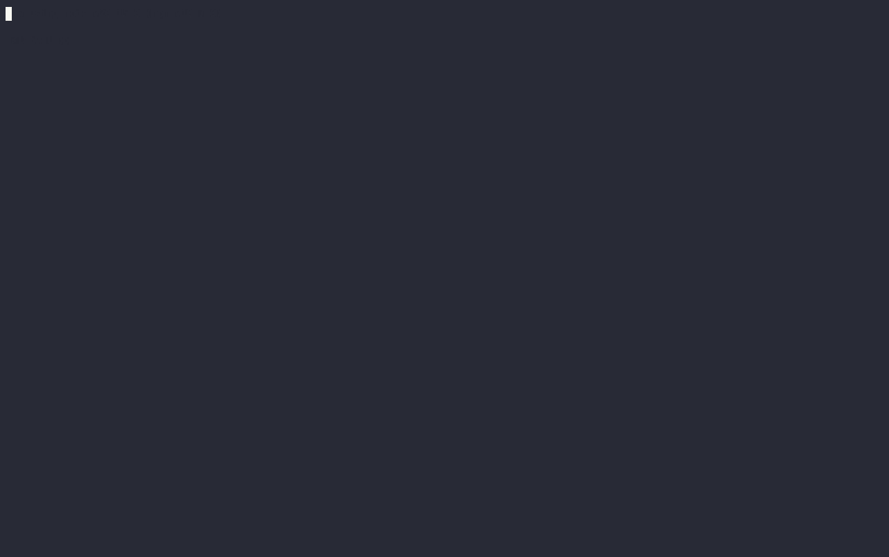

# Validate AWS Policies

A command-line tool that validates AWS IAM policies with the
[IAM Access Analyzer](https://docs.aws.amazon.com/IAM/latest/UserGuide/what-is-access-analyzer.html)
`ValidatePolicy` API and the Access Analyzer custom policy checks, and writes reports for
people and for CI/CD pipelines.

## Features

- **Policy types:** identity, resource, service control (SCP) and resource control (RCP) policies, with resource-specific checks for S3 buckets, access points, role trust policies and DynamoDB tables.
- **Custom policy checks:** fail a build when a policy grants new access compared to a baseline, grants access you have forbidden, or can be public.
- **Reports:** JSON, text, [HTML](assets/sample-report.html), Markdown, JUnit XML (CodeBuild, Azure Pipelines, Jenkins, GitLab) and SARIF (GitHub code scanning).
- **Pipeline friendly:** specific exit codes, `--fail-on` severity thresholds, `--dry-run`, JSON logs, S3 upload and ZIP archives.
- **Configuration:** command line, YAML or TOML file, and environment variables, with a documented precedence.
- **Compatible:** upgrading within 3.x never removes a flag, config key or exit code. Newer API features are used only when your installed boto3 supports them.

## Quick start

```bash
pip install validate-aws-policies

# Validate every *.json file in a directory (output is JSON on stdout)
validate-aws-policies --policies-path ./policies --profile my-profile

# Self-contained HTML report
validate-aws-policies -d ./policies -p my-profile --format html

# Service control policies, failing the build on any warning
validate-aws-policies -d ./scps --policy-type scp --fail-on warning

# Block pull requests that grant more access than the baseline
validate-aws-policies -d ./policies --check-no-new-access --reference-path ./baseline
```

## Requirements

- Python 3.8 or newer
- AWS credentials (profile, SSO or environment) allowed to call `access-analyzer:ValidatePolicy`.
  Custom checks and S3 upload need more permissions, see [Installation](installation.md#iam-permissions).

## Where to go next

| I want to... | Read |
|---|---|
| Install and set up AWS access | [Installation](installation.md) |
| Run it and read the output | [Usage](usage.md) |
| Use a config file or environment variables | [Configuration](configuration.md) |
| Validate SCPs, trust policies or bucket policies, or add custom checks | [Policy Types & Custom Checks](access-analyzer-features.md) |
| Copy a working command or pipeline | [Examples](examples.md), [AWS CodeBuild](codebuild.md), [JUnit XML](JUNIT_XML_REPORT.md) |
| Call it from Python or look up every option | [API Reference](api.md) |
| Contribute or cut a release | [Development](development.md) |

## Example output



Open the [sample HTML report](assets/sample-report.html) to see the report format.

## License and support

Apache License 2.0, see [LICENSE](https://github.com/velez94/validate-aws-policies/blob/main/LICENSE).
Report problems or ask questions in
[GitHub Issues](https://github.com/velez94/validate-aws-policies/issues). Pull requests are
welcome, see [Development](development.md).
